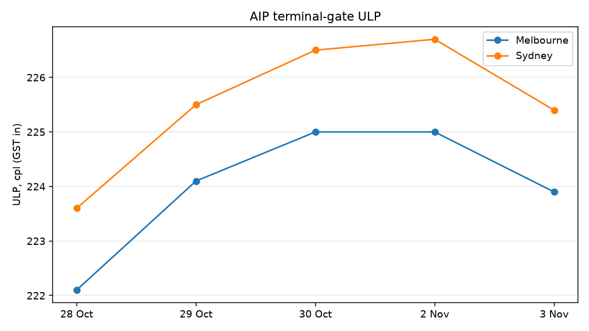

# Should a Melbourne driver fill up this week?

**As of 3 Nov 2026:** Melbourne wholesale ULP is **223.9 cpl**, **1.1 cpl below** Friday’s high, **1.5 cpl below Sydney**. If the tank can last a few days, wait. If the tank is low, fill.



| | |
| --- | --- |
| Question | Fill this week, or wait? Is Melbourne cheaper than Sydney at the gate? |
| Data | AIP Terminal Gate Prices (official weekday wholesale, GST in, cpl) |
| Tools | Python, pandas, matplotlib, Excel-ready CSV |
| Caveat | Wholesale is not the pump |

## Limitations

This is one AIP week (28 Oct–3 Nov). The call follows the latest move, not a backtest. “Wait when prices are flat or falling” is not tested on other weeks. AIP is wholesale, not the pump.

## How to reproduce

```powershell
cd melbourne_fuel
python -m venv .venv
.\.venv\Scripts\Activate.ps1
pip install -r requirements.txt
python src\pull_aip.py
python src\clean_aip.py
python src\plot_aip.py
```

Then open `data/processed/aip_ulp.csv` and `outputs/findings.md`.

## Files

| File | Why |
| --- | --- |
| `src/pull_aip.py` | Downloads the official AIP page |
| `src/clean_aip.py` | Turns the ULP table into a CSV |
| `src/plot_aip.py` | Melbourne vs Sydney line chart |
| `data/processed/aip_ulp.csv` | Excel source |
| `outputs/findings.md` | The call and the caveat |
| `outputs/melbourne_vs_sydney.png` | Chart for the README |
